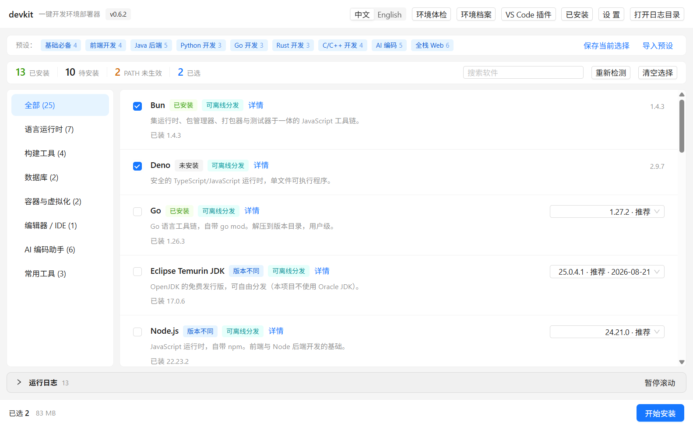
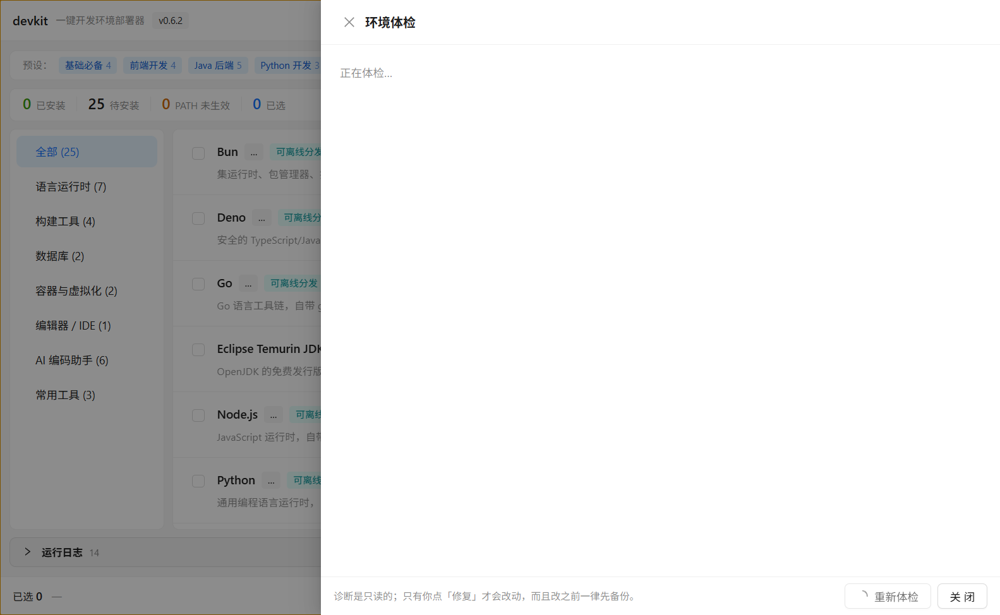
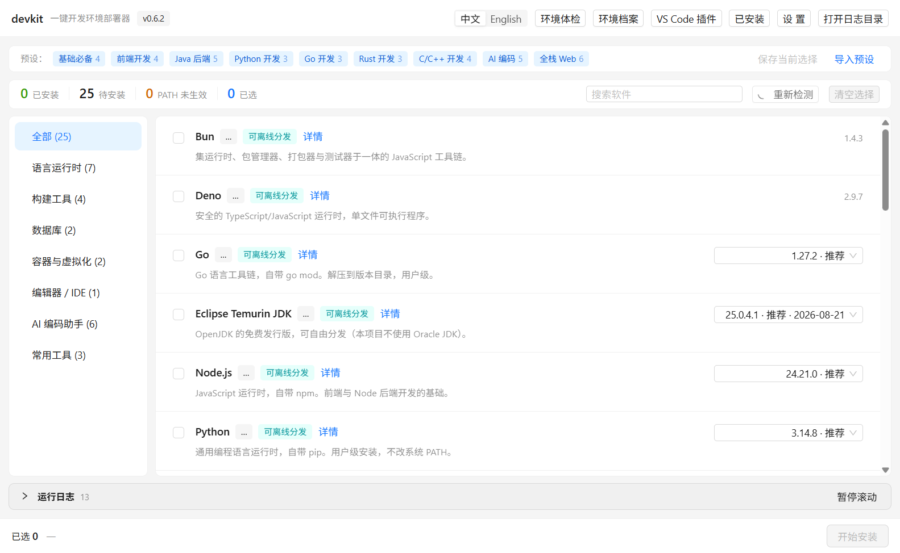

# devkit

> **Windows 开发环境部署器 · 技术预览（Technical Preview）**
>
> **目标**：在**一台什么都没装的 Windows 电脑**上，用图形界面勾选需要的东西，一次把开发环境**装好、配好、验好**。
>
> ⚠️ **现在还不是「一键搞定」** —— 核心场景（干净机器）尚未验收，安装包也未签名。
> 请先读完下面这段警告，再决定要不要试。

[](https://github.com/xinghe-labs/devkit/actions/workflows/ci.yml)
[](LICENSE)

## 界面一览

| 主界面：勾选 → 安装 | 安装流程：预检 → 下载 → 校验 → 安装 → 自检 |
| --- | --- |
|  |  |

| 环境体检：PATH 脏数据诊断 | 环境档案 / 换机迁移 |
| --- | --- |
|  |  |

> [!WARNING]
> **技术预览（v0.6.x）· 安装包未签名 —— 欢迎试用，但请先读完这一段**
>
> - **安装包没有代码签名。** Windows SmartScreen 会弹「Windows 已保护你的电脑」。
>   这是**预期行为**（不是文件损坏、也不是被篡改），点「更多信息」→「仍要运行」即可。
>   签名**暂缓申请**：SignPath Foundation 对可执行程序要求「一定的可验证声誉」，
>   而这个项目刚公开。等积累一些实际使用后再申请 —— 签名步骤已经接进 `release.yml`，
>   审批通过后填几个 secret 就会自动生效，详见 [docs/CODE-SIGNING.md](./docs/CODE-SIGNING.md)。
> - **还没在「全新 Windows 机器」上做过端到端验收。** devkit 的定位是「在什么都没装的机器上装环境」，
>   但目前的真机验证都是在**已经装好 Node/Python/Git/Maven 的开发机**上做的。
>   已知未验证项逐条列在 [docs/VERIFICATION.md](./docs/VERIFICATION.md) §5，不藏。
> - **目前只在 Windows 11（中文系统 + 中文用户名）上验证过。** SPEC 声明的最低支持是
>   Windows 10 22H2，英文系统只跑过 CI 的界面冒烟。
> - **机器级安装（MSI + UAC 提权）没有真机验证过**，只有协议级测试。
>
> 结论：**欢迎试用并提 issue，但别拿它当生产环境的一次性方案。**
> 补完「签名」与「干净机器验收」之后才会去掉这个警告。

## 它解决什么问题

不是"下载安装包"——那件事 winget / Chocolatey / Scoop 已经做了。devkit 解决的是后面那三件事：

1. **不知道装哪个版本、装到哪、装完还要配什么**
2. **装完了但 PATH / 环境变量 / 镜像源没配**，跑不起来，或者慢得离谱
3. **装到一半失败**，不知道失败在哪、装了几成

所以 devkit 的核心是 **「安装 + 配置 + 自检」三件套的自动化**，外加**可回退**：
改 PATH 前先备份原值，取消激活时按记录精确移除，不靠"猜哪条是脏数据"。

## 能装什么

**25 项清单 / 22 项可装**，完整列表见 [docs/TOOLS.md](./docs/TOOLS.md)。概要：

- **运行时**：Node.js（三条 LTS 线）· Python（3.15/3.14/3.13）· JDK 25/21/17 · Go 1.27/1.26 · Rust · Deno · Bun
- **构建**：Maven（3.10/3.9）· Gradle（9.x/8.x）· CMake · Ninja
- **工具**：Git · pnpm · VS Code · SQLite · 7-Zip（机器级，需管理员）
- **AI 编码 agent**：Claude Code · Codex CLI · OpenCode · Gemini CLI · Copilot CLI · Qwen Code
- **仅检测**：WSL2 · Docker Desktop · PostgreSQL（安装方式不适合"装进版本目录"，不填占位数据）

每个工具提供**多个常用版本**可选（如 Node 24/22/20、JDK 25/21/17），
默认推荐 LTS/稳定版；版本号与 SHA-256 全部由 `pnpm manifest:refresh` 从**官方渠道**取。

## 有什么特性

- **安装 ≠ 激活**：安装只写 `%USERPROFILE%\.devkit\versions\`，不改 PATH、不写 Program Files、
  不需要管理员；激活（写 PATH/环境变量）才动环境，且改前备份、按记录精确还原
- **前置依赖拦截**：选 Maven 会提醒先装 JDK，npm 类工具会提醒先装 Node（机器上已有就放行）
- **装后自检**：用「新终端」环境跑一次 `node -v` 这类命令，确认真的能用，而不是假成功
- **环境体检**：只读诊断 PATH 脏数据（截断残留 / 拼错变量 / 重复 / 多副本冲突），
  修复前备份、修复后复验
- **环境档案**：导出/导入一份 JSON，换机时带走工具清单、自定义 PATH、环境变量、镜像源
  （**不含任何密钥**）
- **失败可续跑**：中断后重启能继续未完成的计划；每一步的日志、来源、哈希都进报告
- **零遥测**：没有任何数据上报；日志只落本地

技术细节见 [SPEC.md](./SPEC.md)（需求与设计，含全部决策表）。

## 快速开始

1. 从 [Releases](https://github.com/xinghe-labs/devkit/releases/latest) 下载
   `devkit-<版本>-setup.exe`（安装版）或 `-portable.exe`（免安装）
2. （首次运行被 SmartScreen 拦时）点「更多信息」→「仍要运行」
3. 选一个预设（前端 / Java / AI 编码…）或自己勾选 → 点「安装」
4. 装完用「环境体检」确认 PATH 与命令解析没问题

## 开发

```bash
pnpm install
pnpm dev            # 开发模式
pnpm typecheck && pnpm lint && pnpm test && pnpm manifest:check   # 提交前的门禁
```

详见 [CONTRIBUTING.md](./CONTRIBUTING.md)（含本项目的 6 条硬规矩）。

## 文档

| 文档 | 内容 |
| --- | --- |
| [SPEC.md](./SPEC.md) | 需求与设计规格（FR-1~24、决策表、风险表） |
| [docs/VERIFICATION.md](./docs/VERIFICATION.md) | **实测记录**：每条结论附真实命令与输出，含未验证清单 |
| [docs/TOOLS.md](./docs/TOOLS.md) | 25 项清单：版本、安装方式、供应链说明 |
| [docs/market-research.md](./docs/market-research.md) | 市场调研：痛点证据与竞品缺口 |
| [docs/security-review.md](./docs/security-review.md) | 独立安全审查（3 高危等，均已修复带回归测试） |
| [docs/CODE-SIGNING.md](./docs/CODE-SIGNING.md) | 签名方案与暂缓申请的原因 |

## 参与贡献

开发环境搭建、提交规范、本项目的几条硬规矩，见 [CONTRIBUTING.md](./CONTRIBUTING.md)。
发现安全漏洞请走 [SECURITY.md](./SECURITY.md) 的私密通道，不要开公开 issue。

## Code signing policy（代码签名策略）

> Free code signing provided by [SignPath.io](https://about.signpath.io), certificate by [SignPath Foundation](https://signpath.org).

**Authors / Reviewers / Approvers**（当前为单人项目，三角色同一人）：
[@xinghe-labs](https://github.com/xinghe-labs)。

**隐私**：本程序不会向任何网络系统传输信息，除非用户明确要求；日志只落本地。
**系统变更**：改 PATH / 环境变量 / 镜像源前会先说明并备份原值，可还原、可逐项卸载。

签名尚未启用（原因见顶部警告），审批通过并配置后自动生效，详见
[docs/CODE-SIGNING.md](./docs/CODE-SIGNING.md)。

## License

[MIT](./LICENSE)


